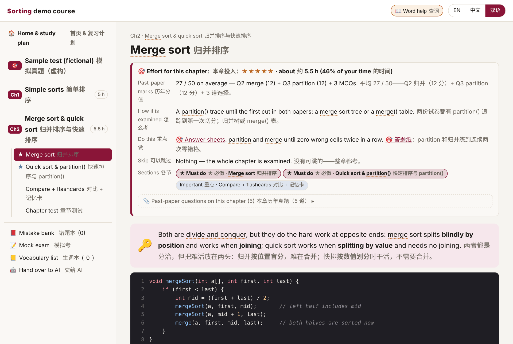
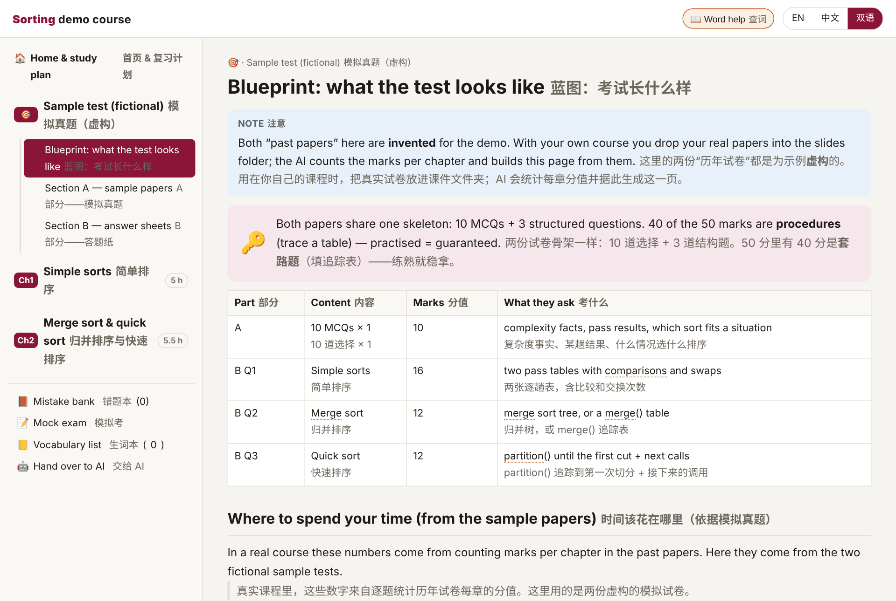
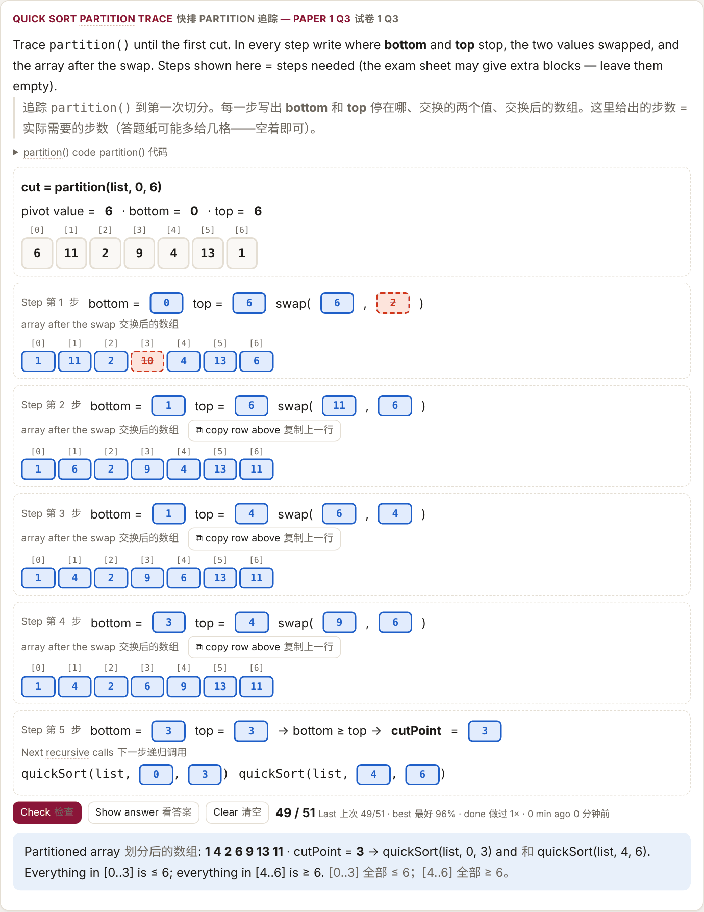
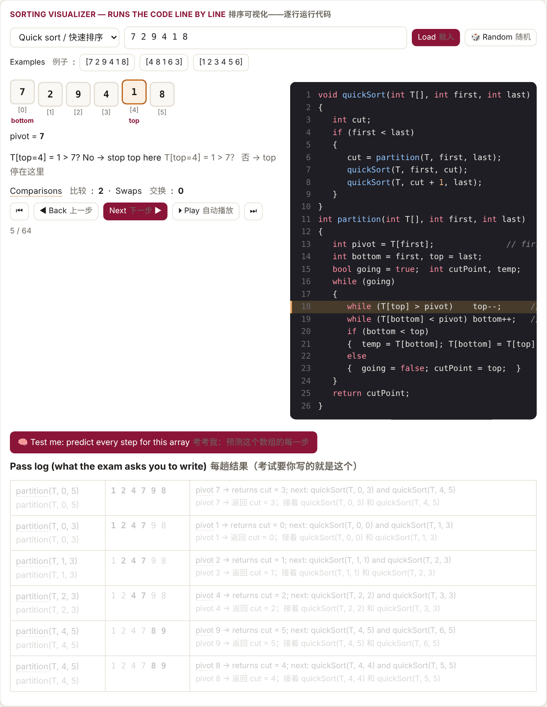
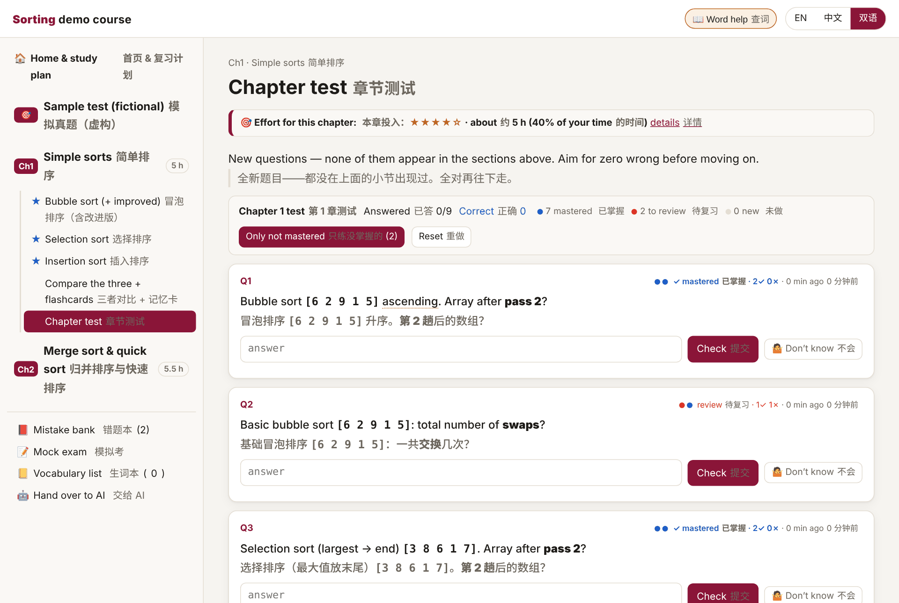
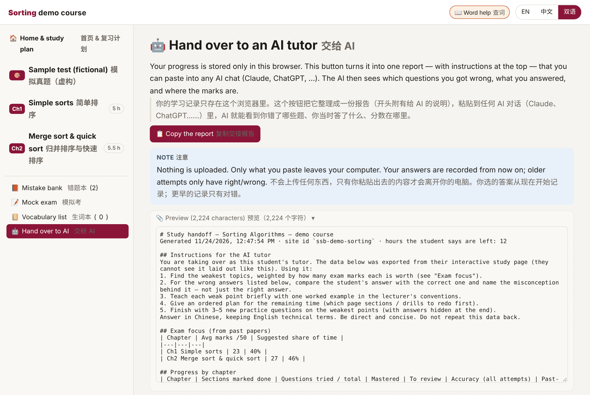
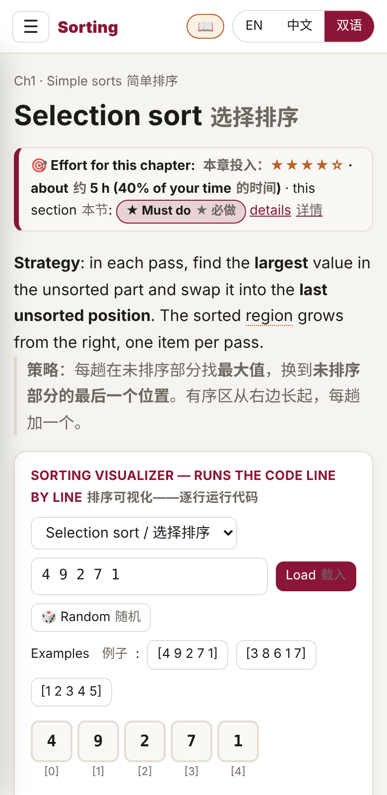

<div align="center">

**English** · [简体中文](README.zh-CN.md)

# study-site-builder

**Lecture slides + past papers → one offline, bilingual study website that tells you where the marks are — and drills you until you stop losing them.**

An [Agent Skill](https://agentskills.io) for Claude, Codex and other coding agents. You give it a folder; it gives you back **one `.html` file**.

[**▶ Open the live demo**](https://zengruizu.github.io/study-site-builder/) · [Quick start](#quick-start) · [What you get](#what-you-get) · [How it works](#how-it-works)



</div>

## Why this and not a quiz app?

Most AI study tools turn your notes into generic flashcards. That helps you *remember* — but exams are lost on **procedures** (trace this table, count these steps) and on **spending time on the wrong chapter**. This skill is built around the exam itself.

| | Typical AI quiz / flashcard tools | Other "slides → HTML" skills | **study-site-builder** |
|---|:---:|:---:|:---:|
| Reads your **past papers** and counts marks per chapter → tells you **how many hours each chapter deserves** | – | – | **✓** |
| Practice in the **same answer-sheet layout as the exam** (pass tables, trace blocks, step tables) with unlimited 🎲 new data | – | rare | **✓** |
| Answer keys **computed by running the code**, not guessed by the model; wrong questions in the past papers are flagged | – | – | **✓** |
| Follows **your lecturer's variant** of an algorithm, not the textbook's | – | partial | **✓** |
| Remembers every attempt per question (✓✓ = mastered) + "only not mastered" practice + mistake bank + timed mock | partial | rare | **✓** |
| One button exports your weak spots as a report for **any AI tutor** to pick up | – | – | **✓** |
| **One file**, works offline, no account, nothing uploaded — send it to classmates | – | ✓ | **✓** |
| Every sentence in **English / 中文 / both**, hard words glossed on tap | – | rare | **✓** |
| Automated **quality gate** (headless browser checks every page, quiz and widget; phone width) | – | – | **✓** |

The honest trade-off: it needs an AI agent that can run code (≈30–90 minutes of agent time per course), and the result is only as good as the slides and papers you give it.

## What you get

<table>
<tr>
<td width="50%"><br><b>Where the marks are.</b> Blueprint of the paper + hours per chapter from the marks you actually lose or win.</td>
<td width="50%"><br><b>Exam-layout answer sheets.</b> Fill every cell, check; right is <b>blue</b>, wrong is <b>red + dashed + struck through</b> (colour-blind safe).</td>
</tr>
<tr>
<td><br><b>Step visualizers</b> that run the lecturer's exact code line by line — and a "predict the next step" mode.</td>
<td><br><b>History per question.</b> Mastered / to review / new, and "only not mastered" practice.</td>
</tr>
<tr>
<td><br><b>Hand over to AI.</b> Your progress, wrong answers and the exam weights as one paste-ready report.</td>
<td align="center"><br><b>Works on a phone</b>, offline, from a single file.</td>
</tr>
</table>

Also in every site: 10+ exercise types (MCQ, multi-select, fill-in, drag-to-bucket, code cloze, true/false sprint, flashcards), collapsed refreshers for knowledge the slides assume, a vocabulary list, a per-chapter test of new questions, and a timed mock exam.

## Quick start

You need an AI agent that can **run code on your computer**: Codex (included with ChatGPT Plus — Codex app or CLI), Claude Code, Cursor, GitHub Copilot agent mode, Gemini CLI… A plain chat window without code execution is not enough.

### Step 1 — install: send this to your AI

```text
Install the Agent Skill from https://github.com/ZengRuizu/study-site-builder for me:
1. Clone it into your user-level skills folder
   (Codex: ~/.agents/skills/study-site-builder · Claude Code: ~/.claude/skills/study-site-builder ·
   any other agent: your own skills folder; if you do not support skills, clone it anywhere and remember the path).
2. Make sure Python 3 works (install it if it is missing). Optional quality gate:
   pip install playwright, then python -m playwright install chromium.
3. Test it: run  python scripts/build.py examples/demo-sorting  inside the cloned folder; it must print "built:".
4. Tell me where it is installed and whether I must restart you before I can use the skill.
```

Codex and Claude Code load new skills when they start — restart them once after installing.

### Step 2 — make your site: put your files in one folder, open the AI in that folder, fill in and send

```text
Use the study-site-builder skill to make a study site for my exam.
- Course:
- Exam: name / date and time / duration / question types (if known)
- Scope: chapters __ to __ ; NOT examined:
- Files in this folder: lecture slides (all) + past papers (years: )
- Language: English / Chinese / both
- Me: hours per day I can study: __ ; weak spots:
If anything is missing, ask me first — do not guess.
```

The agent builds chapter by chapter (about 30–90 minutes for a full course), runs the quality gate and hands you `‹Course›.html`. **That one file is the whole site** — open it in Chrome / Safari / Edge, or send it to classmates.

Want to see the result first? Open the [demo](https://zengruizu.github.io/study-site-builder/) (sorting algorithms, invented sample papers).

<details>
<summary>Other ways to install · run the scripts yourself</summary>

- **By hand:** `git clone https://github.com/ZengRuizu/study-site-builder ~/.agents/skills/study-site-builder` (Codex) or `… ~/.claude/skills/study-site-builder` (Claude Code).
- **Claude app (claude.ai):** download this repository as a zip and upload it in the Skills section of the settings; code execution must be on.
- **Agents without skill support:** they read `AGENTS.md`, which points to `SKILL.md`.
- **Build a course by hand:** `python scripts/build.py examples/demo-sorting` → `examples/demo-sorting/dist/index.html` (use `python3` on macOS/Linux).
- **Quality gate:** `pip install playwright && python -m playwright install chromium`, then `python scripts/verify.py <built.html>` (must print `RESULT: PASS`).

Requirements: Python 3; Node (optional, syntax check); Playwright + Chromium (optional, quality gate).
</details>

## How it works

```
your folder (slides, past papers)
        │  the agent follows SKILL.md
        ▼
course files  ──  course.js · ch1.js … · paper.js · decks.js · glossary.js
        │  scripts/build.py  (inlines engine + course, syntax-checks)
        ▼
ONE .html  ──  scripts/verify.py (every route, quiz, widget, phone width) → PASS
```

The agent writes only **content**; the engine (`engine/`) handles navigation, language switching, quizzes, history, storage, the mistake bank, the mock exam and the AI report. Answer keys for traces come from simulators that run the exact algorithm (`addons/cs-algorithms/sim.js`, testable in Node).

```
SKILL.md            instructions for the agent (the skill itself)
AGENTS.md           pointer for non-Claude agents
engine/             the runtime that is inlined into every site
scripts/            build.py · verify.py (quality gate)
references/         authoring API · pedagogy rules · quality checklist
templates/course/   starting point for a new course
addons/             optional widget packs (cs-algorithms: sort visualizer, exam answer sheets)
examples/           demo-sorting — the demo course source
docs/               the built demo (GitHub Pages) + screenshots
```

## Copyright — please read

Your slides and past papers belong to your lecturer or university. **Keep generated sites for personal study and your classmates; do not publish them or upload course material to this repository.** The demo here is entirely original content, and its "past papers" are invented.

## Status and credits

Built for and battle-tested on a real Data Structures & Algorithms midterm and a Software Engineering midterm at a university (those sites stay private because they contain course material). Issues and ideas are welcome.

Designed and directed by **Zeng Ruizu**; code and content written with the help of AI (Claude).

## License

[MIT](LICENSE) © 2026 Zeng Ruizu
