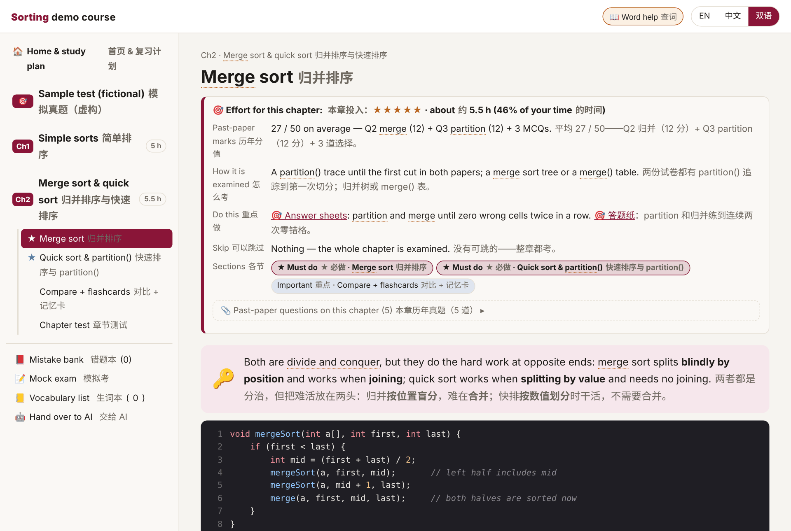
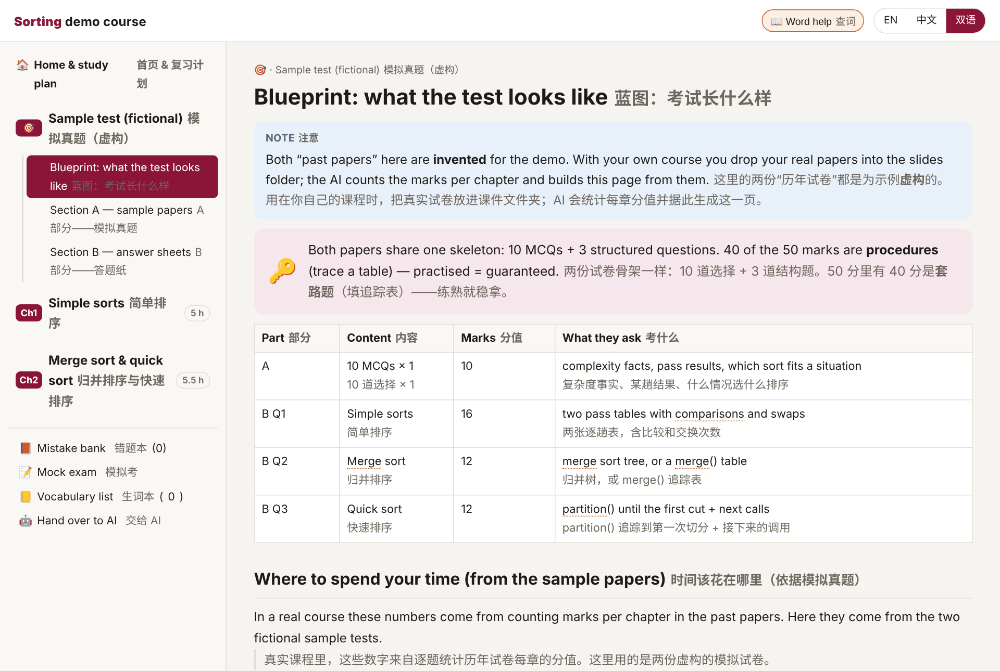
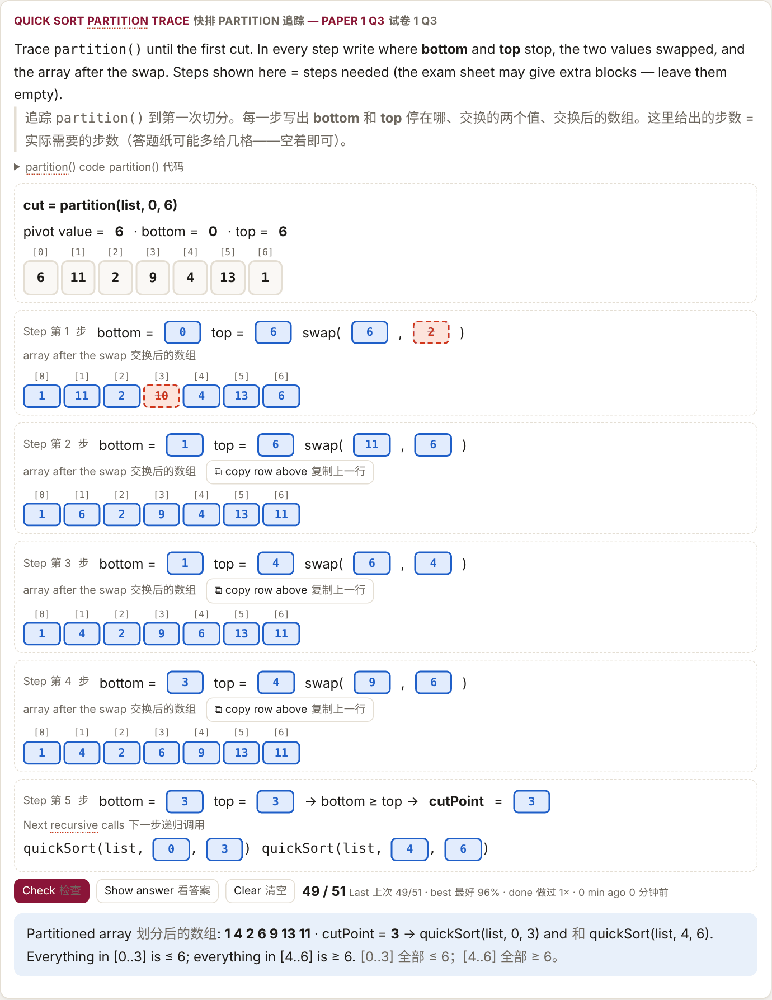
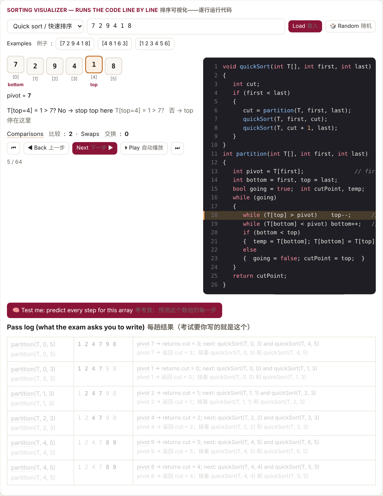
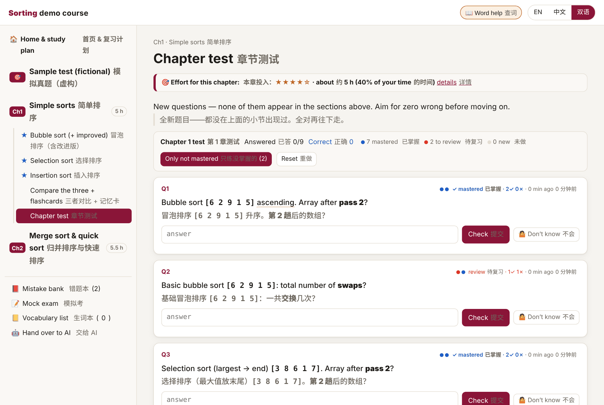
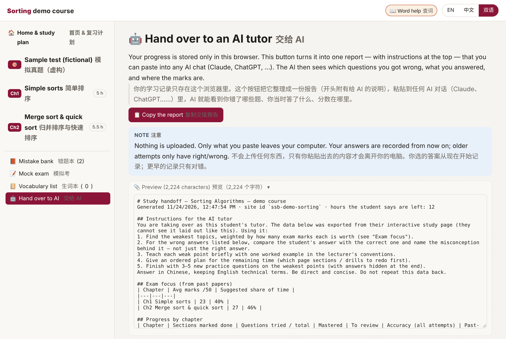
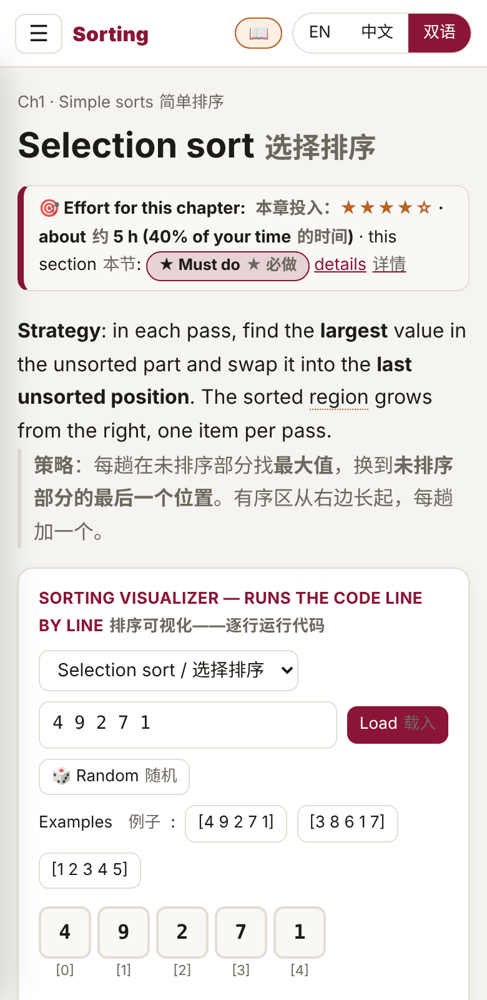

<div align="center">

[English](README.md) · **简体中文**

# study-site-builder

**课件 + 历年试卷 → 一个离线、双语的复习网站：告诉你分在哪里，再把你练到不丢分为止。**

一个 [Agent Skill](https://agentskills.io)，适用于 Claude、Codex 等能运行代码的 AI 智能体。你给它一个文件夹，它还你**一个 `.html` 文件**。

[**▶ 打开在线示例**](https://zengruizu.github.io/study-site-builder/) · [快速开始](#快速开始) · [你会得到什么](#你会得到什么) · [工作原理](#工作原理)



</div>

## 为什么不用普通的刷题 App？

大多数 AI 学习工具把笔记变成通用记忆卡。那能帮你*记住*——但考试真正丢分的地方是**套路题**（填这张追踪表、数这段代码的步数），以及**把时间花错了章节**。这个 skill 围绕考试本身设计。

| | 常见 AI 刷题 / 记忆卡工具 | 其他“课件 → 网页” skill | **study-site-builder** |
|---|:---:|:---:|:---:|
| 读你的**历年试卷**，逐题统计每章分值 → 告诉你**每章该花几小时** | – | – | **✓** |
| 用**和考卷一模一样的答题格式**练习（逐趟表、追踪块、步数表），🎲 无限换数据 | – | 少见 | **✓** |
| 答案**由程序实际运行得出**，不是模型猜的；历年卷里出错的题会被标出 | – | – | **✓** |
| 按**你的讲师的算法版本**来，而不是教科书版本 | – | 部分 | **✓** |
| 记录每道题的每次作答（✓✓ = 已掌握）+“只练没掌握的”+ 错题本 + 计时模拟考 | 部分 | 少见 | **✓** |
| 一键把薄弱点导出成报告，交给**任何 AI 家教**接手 | – | – | **✓** |
| **单个文件**，离线可用，无需账号，不上传任何东西——可以直接发给同学 | – | ✓ | **✓** |
| 每句话都可切换 **English / 中文 / 双语**，难词点一下就有释义 | – | 少见 | **✓** |
| 自动**质量门禁**（无头浏览器检查每个页面、题目、组件和手机宽度） | – | – | **✓** |

坦白说代价是：它需要一个能运行代码的 AI 智能体（每门课约 30–90 分钟的智能体工作时间），而且成品的质量取决于你给的课件和试卷。

## 你会得到什么

<table>
<tr>
<td width="50%"><br><b>分在哪里。</b>试卷蓝图 + 依据真实分值算出的每章时长。</td>
<td width="50%"><br><b>考卷格式答题纸。</b>填满每一格再检查；对的是<b>蓝色</b>，错的是<b>红色 + 虚线 + 删除线</b>（色弱友好）。</td>
</tr>
<tr>
<td><br><b>分步可视化</b>：逐行运行讲师给的原代码，还有“预测下一步”模式。</td>
<td><br><b>每道题的历史记录。</b>已掌握 / 待复习 / 未做，以及“只练没掌握的”。</td>
</tr>
<tr>
<td><br><b>交给 AI。</b>进度、错题、你的错误答案和考试权重，整理成一份可直接粘贴的报告。</td>
<td align="center"><br><b>手机上也能用</b>，离线，只要一个文件。</td>
</tr>
</table>

每个网站还包括：10 多种练习（单选、多选、填空、拖拽归类、代码填空、判断速刷、记忆卡）、课件默认你已经会的背景知识（折叠显示）、生词本、每章一套全新题目的章节测试，以及计时模拟考。

## 快速开始

你需要一个能**在你电脑上运行代码**的 AI 智能体：Codex（ChatGPT Plus 自带，用 Codex 应用或 CLI）、Claude Code、Cursor、GitHub Copilot 智能体模式、Gemini CLI……只能聊天、不能运行代码的对话窗口不够用。

### 第 1 步——安装：把下面这段发给你的 AI

```text
帮我安装这个 Agent Skill：https://github.com/ZengRuizu/study-site-builder
1. 把它 clone 到你的用户级 skills 文件夹
   （Codex：~/.agents/skills/study-site-builder · Claude Code：~/.claude/skills/study-site-builder ·
   其他智能体：你自己的 skills 文件夹；如果你不支持 skill，就 clone 到任意位置并记住路径）。
2. 确认 Python 3 能用（没有就装上）。可选的质量检查：
   pip install playwright，再 python -m playwright install chromium。
3. 测试：在 clone 下来的文件夹里运行  python scripts/build.py examples/demo-sorting ，必须输出 "built:"。
4. 告诉我装在哪里，以及我是否需要重启你才能使用这个 skill。
```

Codex 和 Claude Code 在启动时加载 skill——装好后重启一次。

### 第 2 步——生成网站：把资料放进一个文件夹，在这个文件夹里打开 AI，填好下面这段发出去

```text
用 study-site-builder skill 给我做一个复习网站。
- 课程：
- 考试：名称 / 日期时间 / 时长 / 题型（知道的话）
- 范围：第 __ 章到第 __ 章；明确不考的：
- 这个文件夹里的资料：课件（全部）+ 历年试卷（年份：）
- 语言：中文 / English / 双语
- 我的情况：每天能学 __ 小时；薄弱的地方：
信息不全就先问我，不要猜。
```

智能体会一章一章地做（完整一门课约 30–90 分钟），跑完质量检查后交给你 `‹课程›.html`。**这一个文件就是整个网站**——用 Chrome / Safari / Edge 打开，或者直接发给同学。

想先看看效果？打开[示例](https://zengruizu.github.io/study-site-builder/)（排序算法，试卷为虚构）。

<details>
<summary>其他安装方式 · 自己运行脚本</summary>

- **手动安装：** `git clone https://github.com/ZengRuizu/study-site-builder ~/.agents/skills/study-site-builder`（Codex）或 `… ~/.claude/skills/study-site-builder`（Claude Code）。
- **Claude 应用（claude.ai）：** 把仓库下载成 zip，在设置的 Skills 部分上传；需要开启代码执行。
- **不支持 skill 的智能体：** 它们会读 `AGENTS.md`，再跳到 `SKILL.md`。
- **手动构建一门课：** `python scripts/build.py examples/demo-sorting` → `examples/demo-sorting/dist/index.html`（macOS/Linux 用 `python3`）。
- **质量门禁：** `pip install playwright && python -m playwright install chromium`，然后 `python scripts/verify.py <生成的.html>`（必须输出 `RESULT: PASS`）。

需要：Python 3；Node（可选，语法检查）；Playwright + Chromium（可选，质量门禁）。
</details>

## 工作原理

```
你的文件夹（课件、历年试卷）
        │  智能体按 SKILL.md 执行
        ▼
课程文件  ──  course.js · ch1.js … · paper.js · decks.js · glossary.js
        │  scripts/build.py（把引擎和课程内联进来，并做语法检查）
        ▼
一个 .html  ──  scripts/verify.py（每个页面、题目、组件、手机宽度）→ PASS
```

智能体只写**内容**；引擎（`engine/`）负责导航、语言切换、题目、历史记录、存储、错题本、模拟考和 AI 报告。追踪题的答案来自真正运行算法的模拟器（`addons/cs-algorithms/sim.js`，可以在 Node 里测试）。

```
SKILL.md            给智能体的说明（skill 本体）
AGENTS.md           给非 Claude 智能体的入口
engine/             内联进每个网站的运行时
scripts/            build.py · verify.py（质量门禁）
references/         编写 API · 教学设计规则 · 质量清单
templates/course/   新课程的起点
addons/             可选组件包（cs-algorithms：排序可视化、考卷格式答题纸）
examples/           demo-sorting——示例课程源码
docs/               构建好的示例（GitHub Pages）+ 截图
```

## 版权——请务必阅读

课件和历年试卷属于你的讲师或学校。**生成的网站请只用于自己复习和分享给同学；不要公开发布，也不要把课程资料上传到这个仓库。** 这里的示例全部为原创内容，其中的“历年试卷”是虚构的。

## 状态与致谢

为一所大学的《数据结构与算法》期中考和《软件工程》期中考而打造，并在真实备考中使用（那两个网站含课程资料，所以不公开）。欢迎提 Issue 和想法。

由 **Zeng Ruizu** 设计和主导；代码与内容在 AI（Claude）的协助下完成。

## 许可证

[MIT](LICENSE) © 2026 Zeng Ruizu
